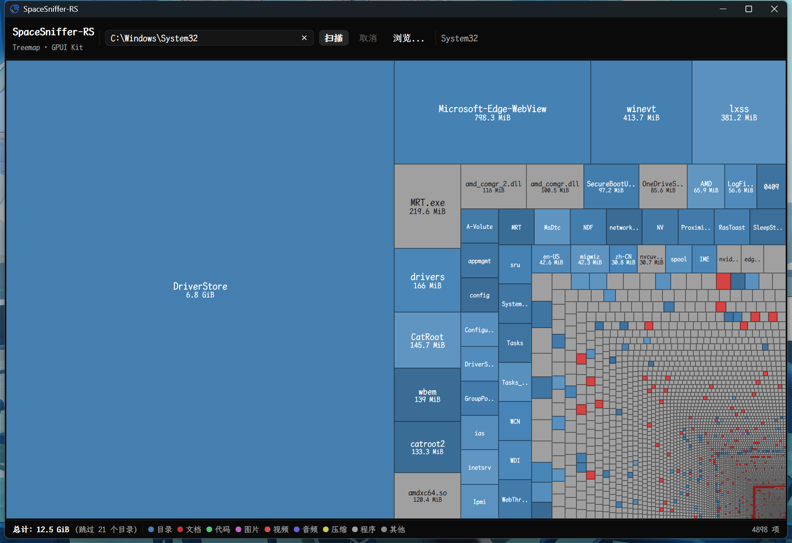

# SpaceSniffer-RS

SpaceSniffer-RS 是一个跨平台磁盘空间分析工具，使用实时 Treemap 可视化，灵感来自 [SpaceSniffer](http://www.uderzo.it/main_products/space_sniffer/).


[](./LICENSE)
[](https://www.rust-lang.org)
[](https://gpui-kit.com)
[](#构建)
[](./locales)


GUI 层基于 **[GPUI Kit](https://gpui-kit.com)**（GPUI + GPUI Component 组件库）；本项目此前使用的是 egui/eframe，已完成整体迁移。



</div>

## 功能

- **Treemap 可视化** — 目录内容按文件大小比例渲染为嵌套矩形（squarified treemap 算法）
- **实时扫描** — 扫描过程中界面持续刷新：顶层条目逐个出现，子目录扫完即补齐（无需等整个扫描结束）
- **目录钻入** — 点击矩形进入子目录；面包屑导航或点击空白处返回上级
- **悬停信息卡** — 跟随指针显示名称、大小、类型（目录条目数 / 扩展名 / 符号链接）与完整路径，靠近窗口边缘时自动翻转
- **右键菜单** — 定位到文件管理器，或删除（删除前有独立确认对话框）
- **颜色编码** — 目录（蓝色，明度按名字微调）、文档（红）、代码（绿）、图片（品红）、视频（深红）、音频（靛蓝）、压缩包（黄）、可执行（灰）、其他（按扩展名哈希着色）
- **格子标签** — 名字 + 大小两行居中；大小按 1024 进制且会进位（`1024 MiB` 显示为 `1 GiB`，整数不带小数点）；窄格子截断名字，大小放不下就不画；文字色按背景亮度自动选黑/白
- **状态栏** — 总占用、跳过目录数、颜色图例、当前层条目数
- **跟随系统深浅色** — 启动时读取窗口外观并应用对应主题；深色下主按钮用深色表面而非亮白填充
- **跨平台** — Windows、macOS、Linux
- **CJK 字体** — 优先内嵌（族名取自字体真实 name 表，注册后再回查确认），否则回退系统 CJK 字体；画布自绘文本通过 `Font::fallbacks` 声明 CJK 回退族（由平台后端消费，Windows 走 DirectWrite）
- **命令行** — `spacesniffer-rs [PATH]` 可直接扫描指定目录

## 构建

环境要求：

- Rust 1.92+（`Cargo.lock` 中 Linux 侧的 `oo7` 要求 1.92，低于此版本 Linux 构建会失败）
- 支持 DirectX（Windows）/ Metal（macOS）/ Vulkan + X11 或 Wayland（Linux）的 GPU 环境

```bash
git clone https://gitee.com/purplesakura/spacesniffer-rs
cd spacesniffer-rs
cargo build --release
```

编译产物位于 `target/release/spacesniffer-rs`（Windows 下为 `.exe`）。

> 首次构建需要编译 GPUI 全家桶，耗时较长；之后的增量构建有缓存。

## 使用方式

```bash
# 直接启动（路径输入框预填用户主目录）
spacesniffer-rs

# 启动即扫描指定目录
spacesniffer-rs D:\Projects
```

1. 输入路径或点击 **浏览...** 选择目录；输入框里按回车等同点击 **扫描**
2. 点击 **扫描** — 矩形实时出现并增长，右上角显示扫描进度徽标
3. **左键** 点击目录矩形进入子目录
4. **左键** 点击空白区域返回上级
5. **右键** 点击任意矩形弹出菜单：
   - **打开文件夹 / 打开文件位置** — 在系统文件管理器中定位
   - **删除文件夹 / 删除文件** — 弹出确认对话框后删除
6. 顶部**面包屑**可跳回任意层级

### 扫描建议

快速体验可扫描某个项目目录或 `~/Documents`。扫描整个用户主目录耗时较长但完全可以。

## 项目结构

```
spacesniffer-rs/
├── Cargo.toml
├── build.rs                  # Windows 图标资源 + CJK 字体内嵌开关
├── LICENSE                   # MIT
├── resources/
│   ├── fonts/                # 可选：编译进二进制的 CJK 字体
│   └── icons/                # 应用图标（打包/资源用）
├── locales/                  # en / zh-CN 文案
├── doc/                      # 截图与 GPUI Kit API 速查（含源码行号实证）
└── src/
    ├── main.rs               # 入口：GPUI Kit 初始化、窗口、资源与字体注册
    ├── app.rs                # 应用状态机：扫描调度、导航、命中测试、删除、Render
    ├── views/
    │   ├── toolbar.rs        # 顶部工具栏 + 面包屑
    │   ├── treemap_view.rs   # canvas 自绘 Treemap、悬停信息卡、右键浮层
    │   ├── states.rs         # 欢迎页 / 扫描中 / 出错
    │   └── status_bar.rs     # 状态栏与图例
    ├── colors.rs             # 扩展名 → 颜色
    ├── treemap.rs            # squarified treemap 布局（纯几何，带单测）
    ├── scanner.rs            # 递归目录扫描（独立线程 + 增量快照）
    ├── fonts.rs              # CJK 字体注册与回退族
    ├── locales.rs            # 系统语言检测
    └── util.rs               # 格式化、路径与文本工具
```

### 核心实现

- **Squarified Treemap**（Bruls, Huizing, van Wijk）— 生成的矩形长宽比尽可能接近 1:1
- **增量扫描** — 扫描线程每 250ms 发送部分树快照，UI 以 100ms 轮询刷新，实现实时渲染
- **单块画布绘制** — 所有格子用一块 `canvas` 自绘：`prepaint` 里算布局并 `shape_line` 排版文本，`paint` 里只提交 quad；几千个格子也不会变成几千个 element
- **命中测试** — 布局结果缓存成 `Rc<Vec<(usize, Bounds)>>`，鼠标移动/点击只在缓存里做一次线性命中，悬停序号变化才重绘
- **坐标约定** — 画布、命中测试、右键菜单统一使用窗口坐标，避免局部坐标换算

### 符号链接与目录环

扫描器**不跟随符号链接**（Unix 上 `DirEntry::metadata()` 是 `lstat` 语义，Windows 上不解析 reparse point），所以 `ln -s . loop` 这类环天然安全，链接目标也不会被重复计数。链接本身会作为条目出现在结果里，悬停时信息卡标明「符号链接（不跟随）」。

`stat` 拦不住的环另外做了两层兜底：

- **祖先链检测** — Unix 上维护 `(dev, ino)` 祖先表，`mount --bind /a /a/b` 这种真目录环一旦绕回祖先就只留空占位、不再展开；
- **深度上限** — 递归最多 256 层，异常深的树不会把栈吃穿。

被跳过的目录计入状态栏的「跳过 N 个目录」。0 字节的条目（空目录、空文件、Windows 目录联接）会分到一小块保底面积（单个最多 0.4%，全部合计最多 10%），否则它们既看不见也点不到；空目录可以直接点进去，进去后显示「(空目录)」，点空白处返回。已知限制：硬链接在 Linux 上会被各自的父目录各计一次（与 `du` 默认行为一致）。


## 依赖

| Crate | 用途 |
|-------|------|
| `gpui-kit` | GUI 框架：GPUI + GPUI Component（按钮、输入框、面包屑、右键菜单、对话框、通知、主题） |
| `rust-i18n` | 中英文案 |
| `winres`（build） | Windows exe 图标与版本资源 |

目录选择使用 GPUI 自带的 `prompt_for_paths`，不再需要额外对话框 crate。

## 从 egui 迁移

| egui / eframe | GPUI Kit |
|---|---|
| `impl eframe::App::update` | `impl Render::render` + `Entity` 状态 |
| 即时模式逐帧重建 | 视图按 `cx.notify()` 失效重建 |
| `ui.allocate_painter` + `painter.rect_filled` | `canvas(prepaint, paint)` + `window.paint_quad(fill/outline)` |
| `painter.text` | `window.text_system().shape_line` + `ShapedLine::paint` |
| `egui::Window` 确认框 | `WindowExt::open_alert_dialog` |
| `Area` 手搓右键菜单 | `PopupMenu` + `deferred(anchored(..))` |
| 轮询 `request_repaint_after` | `cx.spawn` + `background_executor().timer` |
| `rfd::FileDialog` | `cx.prompt_for_paths` |

`doc/` 下留了两份 API 速查（gpui-component 0.8.0、gpui-pre 0.3.9 绘制层），每条都带本地源码行号，升级版本时可对照排查。

## License

本项目以 **MIT License** 发布，版权归 Purple桜 所有，许可证全文见 [LICENSE](./LICENSE)。

简单说，MIT 允许你：**自由使用、修改、再发布、商用、闭源分发**，唯一义务是保留版权声明和许可声明；同时作者不对软件的任何后果负责（无担保）。

<details>
<summary><b>展开查看 MIT 许可证全文</b></summary>

```text
MIT License

Copyright (c) 2026 CYANRHYTHM <alicecats@qq.com>

Permission is hereby granted, free of charge, to any person obtaining a copy
of this software and associated documentation files (the "Software"), to deal
in the Software without restriction, including without limitation the rights
to use, copy, modify, merge, publish, distribute, sublicense, and/or sell
copies of the Software, and to permit persons to whom the Software is
furnished to do so, subject to the following conditions:

The above copyright notice and this permission notice shall be included in all
copies or substantial portions of the Software.

THE SOFTWARE IS PROVIDED "AS IS", WITHOUT WARRANTY OF ANY KIND, EXPRESS OR
IMPLIED, INCLUDING BUT NOT LIMITED TO THE WARRANTIES OF MERCHANTABILITY,
FITNESS FOR A PARTICULAR PURPOSE AND NONINFRINGEMENT. IN NO EVENT SHALL THE
AUTHORS OR COPYRIGHT HOLDERS BE LIABLE FOR ANY CLAIM, DAMAGES OR OTHER
LIABILITY, WHETHER IN AN ACTION OF CONTRACT, TORT OR OTHERWISE, ARISING FROM,
OUT OF OR IN CONNECTION WITH THE SOFTWARE OR THE USE OR OTHER DEALINGS IN THE
SOFTWARE.
```

</details>

### 第三方组件

本项目自身代码为 MIT，运行时依赖的组件按其各自许可证分发，均与本项目兼容：

| 组件 | 许可证 | 说明 |
|---|---|---|
| [GPUI Kit](https://gpui-kit.com) / GPUI / GPUI Component | Apache-2.0 | GUI 框架与组件库 |
| [Lucide](https://lucide.dev) 图标 | ISC | 经 `gpui-kit-assets` 打包进可执行文件 |
| [rust-i18n](https://github.com/longbridge/rust-i18n) | MIT | 国际化 |
| 内嵌字体 `YaHei Monaco Hybrid` | 随项目分发 | 见 `resources/fonts/`；再次分发时请确认字体本身的授权 |

> 若要对外分发二进制，建议同时附带 Apache-2.0 的 `NOTICE`（GPUI Kit 的要求）。

